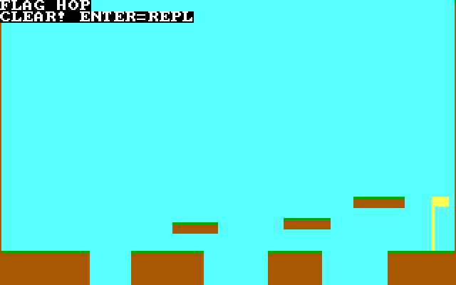

# Flag Hop

Flag Hop is a **502-byte** platformer written in 16-bit x86 assembly. Jump across three pits, pick up three optional coins, and reach the flag to clear the level. Falling into a pit resets the course.


## Play

Download [flaghop.com](flaghop.com?raw=true), put it in a directory accessible from DOS, and run `FLAGHOP.COM` at the DOS prompt. Use a 386 or newer x86 machine or emulator with VGA and an AT-compatible BIOS that supports the timed wait service (`INT 15h`, `AH=86h`).

| Key | Action |
| --- | --- |
| Left / Right | Run |
| Space | Jump. Hold to jump again on landing. |
| Enter | Replay after reaching the flag |
| Esc | Return to DOS |



## Build

Assemble [flaghop.asm](flaghop.asm) with NASM. Yasm accepts the same arguments.

```sh
nasm -f bin flaghop.asm -o flaghop.com
wc -c < flaghop.com  # 502
```

The output is a flat DOS `.COM` file. An assembly-time guard rejects output of 512 bytes or more. The byte count covers the complete executable, including the level data and both messages.

## How it fits

- **The framebuffer is the collision map.** VGA mode 13h stores one byte per pixel. After checking for the flag and coins, the game tests the low bit of the palette index. Even values block movement, so grass and dirt can have different colors while sharing the same collision rule.
- **A position is a video-memory offset.** Add ±1 to move horizontally or ±320 to move vertically. Motion advances one pixel at a time and checks the player’s four corners before accepting each step.
- **A coin carries its own location.** Coins start on four-pixel boundaries. On contact, the game rounds down to the coin’s left edge and scans upward to find its top row, then erases the rectangle. The level stores only their starting positions.
- **One rectangle routine draws almost everything.** Terrain strips store a two-byte offset and one byte each for width and height. The same routine draws the terrain, coins, flag, and player, and erases the player between frames.

The screenshots were captured in QEMU. An emulator playthrough collected all three coins, cleared the level, replayed, and exited. Pit respawn was also verified.
