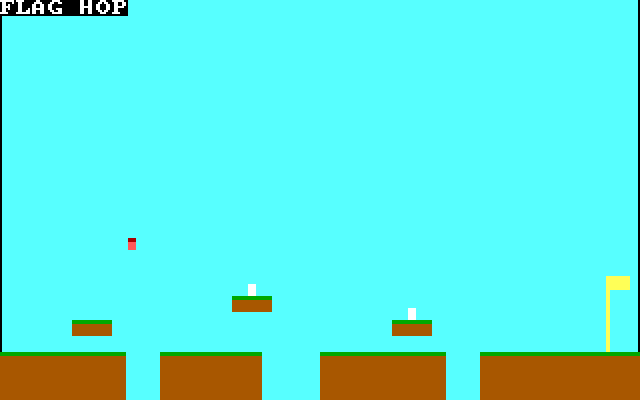

# Flag Hop

Flag Hop is a **469-byte** platformer written in 16-bit x86 assembly. Jump across three pits, pick up three optional coins, and reach the flag to clear the course. The terrain generator creates **32,768 different layouts** with varying pit widths and platform heights.



## Play

Download [flaghop.com](flaghop.com?raw=true), put it in a directory accessible from DOS, and run `FLAGHOP.COM` at the DOS prompt. Use a 386 or newer x86 machine or emulator with VGA and an AT-compatible BIOS that supports the timed wait service (`INT 15h`, `AH=86h`).

| Key | Action |
| --- | --- |
| Left / Right | Run |
| Space | Jump. Hold to jump again on landing. |
| Enter | Generate a different course after reaching the flag |
| Esc | Return to DOS |

Falling into a pit restores the same course and its coins. The first course is seeded from the BIOS timer.


## Build

Assemble [flaghop.asm](flaghop.asm) with NASM. Yasm accepts the same arguments.

```sh
nasm -f bin flaghop.asm -o flaghop.com
wc -c < flaghop.com  # 469
```

The output is a flat DOS `.COM` file. An assembly-time guard rejects output of 512 bytes or more. The byte count covers the complete executable, including the terrain generator and both messages.

## How it fits

- **The seed encodes the whole course.** Each of the first three 80-pixel sections rotates a copy of the 16-bit seed by five bits. Four bits select a 17–32 pixel pit, and one selects the height of a platform with a coin. The rotations expose a different five-bit group each time. The original seed stays on the stack, so each pit fall reproduces the same course.
- **The framebuffer is the collision map.** VGA mode 13h stores one byte per pixel. After checking for the flag and coins, the game tests the low bit of the palette index. Even values block movement. The sky draw skips the first and last columns, using the black pixels left by the BIOS as walls.
- **A position is a video-memory offset.** Add ±1 to move horizontally or ±320 to move vertically. Motion advances one pixel at a time and checks the player’s four corners before accepting each step.
- **A coin carries its own location.** The generator places each coin on a four-pixel boundary. On contact, the game rounds down to the coin’s left edge and scans upward to find its top row, then erases the rectangle.
- **One rectangle routine draws almost everything.** It fills the sky, draws terrain and sprites, and clears the player and collected coins.

The screenshots were captured in QEMU. Emulator playtests checked pit respawn, collecting all three coins, clearing the course, generating a different one, and exiting. A simulation of the movement and collision rules found a route to the flag with all three coins for every generated layout.
